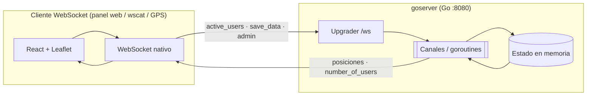
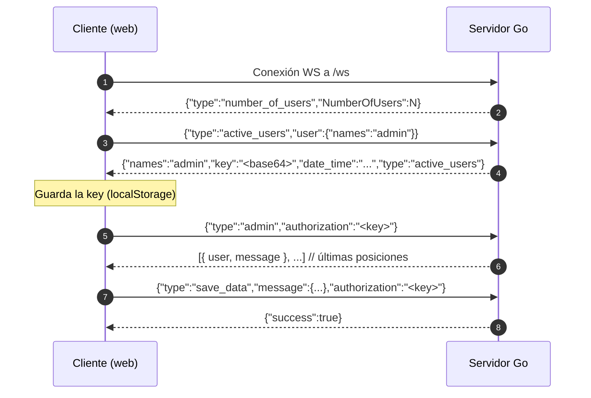

# LocGPS — Monitoreo en tiempo real

[](https://go.dev/)
[](https://gin-gonic.com/)
[](https://github.com/gorilla/websocket)
[](https://react.dev/)
[](https://vite.dev/)

Sistema de rastreo GPS en tiempo real compuesto por un **servidor de mensajería WebSocket** escrito en Go y un **panel de monitoreo web**:

| Componente | Rol | Tecnología |
| --- | --- | --- |
| `goserver/` | Servidor de mensajería en tiempo real | Go + Gin + Gorilla WebSocket |
| `locgpsweb/` | Panel de monitoreo (visualiza la flota) | React + TypeScript + Vite + Leaflet |

Cualquier cliente WebSocket compatible con el protocolo descrito (el panel web, `wscat` o un dispositivo GPS externo) puede publicar su latitud/longitud. El servidor las almacena por conexión y las retransmite en vivo; el panel web las dibuja sobre un mapa de OpenStreetMap.

---

## Tabla de contenido

1. [Descripción](#1-descripción)
2. [Características](#2-características)
3. [Arquitectura](#3-arquitectura)
4. [Estructura del repositorio](#4-estructura-del-repositorio)
5. [Stack tecnológico](#5-stack-tecnológico)
6. [Requisitos previos](#6-requisitos-previos)
7. [Instalación y ejecución](#7-instalación-y-ejecución)
8. [Configuración de endpoints](#8-configuración-de-endpoints)
9. [**API WebSocket — `ws://localhost:8080/ws`**](#9-api-websocket--wslocalhost8080ws)
10. [API REST](#10-api-rest)
11. [Panel web](#11-panel-web)
12. [Recursos](#12-recursos)

---

## 1. Descripción

**LocGPS** es un proyecto académico de geolocalización que demuestra el uso de WebSockets para transmitir posiciones GPS con baja latencia. Su flujo principal es:

1. Un cliente se conecta al WebSocket y solicita un **registro de usuario** (`active_users`).
2. El servidor responde con una **clave** (`key`) única para esa conexión.
3. El cliente envía su posición cada vez que cambia (`save_data`).
4. El servidor guarda **la última posición de cada conexión** en memoria.
5. El panel web, registrado como administrador, consulta periódicamente todas las posiciones (`admin`) y las pinta en el mapa.
6. Opcionalmente, cualquier cliente puede difundir su posición a los demás (`locations` / `active_users_all`).

> El proyecto está pensado para redes locales o demostraciones. No incluye base de datos: **todo el estado vive en memoria del proceso Go**.

---

## 2. Características

- **Rastreo en vivo** — actualizaciones de posición por evento o por intervalo configurable.
- **WebSocket nativo** — protocolo JSON simple, sin dependencias de brokers externos.
- **Mapa interactivo** — Leaflet + OpenStreetMap con marcadores personalizados y popups.
- **Registro por conexión** — cada socket recibe su propia clave y nombre de usuario.
- **Contador de conectados** — notificación `number_of_users` en cada conexión/desconexión.
- **Modo administrador** — consulta consolidada de todas las posiciones guardadas.
- **UI moderna** — panel responsive con estado de conexión, última actualización y lista de vehículos.
- **Backend agnóstico al cliente** — cualquier implementación que respete el protocolo JSON puede conectarse.

---

## 3. Arquitectura



Los tres mapas que conforman el estado del servidor son `clients` (conexiones activas), `register_users` (usuario registrado por conexión) y `users_messages` (última posición guardada por conexión). Cada canal interno es atendido por una goroutine dedicada, de modo que la lectura del socket nunca se bloquea esperando escrituras.

---

## 4. Estructura del repositorio

```text
loc_gps_android_go/
├── goserver/                    # Servidor Go (REST + WebSocket)
│   ├── main.go                  # Punto de entrada, router Gin y endpoints demo
│   ├── go.mod / go.sum
│   ├── models/                  # DTOs compartidos (MDataSocket, MUser, MMessage...)
│   │   ├── MDataSocket.go       # Sobre (envelope) de todos los mensajes
│   │   ├── MMessage.go          # id, latitud, longitud, type
│   │   ├── MMessageData.go      # { user, message }
│   │   ├── MUser.go             # names, key, date_time, type
│   │   ├── MUserConnected.go    # { type, NumberOfUsers }
│   │   ├── MStateMessage.go     # { success }
│   │   ├── MErrorSocket.go      # { error }
│   │   └── MPerson.go           # Modelo de ejemplo para la API REST
│   ├── utils/
│   │   ├── ConfigureWebSocket.go# Hub, canales y handlers del WebSocket
│   │   ├── DataStatic.go        # Constantes de tipos + SecretKey
│   │   ├── Methods.go           # Generación de claves, Base64, fechas
│   │   └── MathFun.go           # Operaciones matemáticas de ejemplo
│   └── test/test.go             # Sandbox de utilidades (no es _test.go)
│
├── locgpsweb/                   # Panel de monitoreo (React + Vite)
│   ├── src/
│   │   ├── main/Main.tsx        # Mapa Leaflet + panel lateral
│   │   ├── utils/WebSocket.tsx  # Cliente WS (se registra como "admin")
│   │   ├── utils/BaseUrl.tsx    # URL del socket
│   │   └── intefaces/           # Tipos TypeScript del protocolo
│   ├── vite.config.ts
│   └── package.json
│
├── recursos.txt                 # Notas y enlaces de aprendizaje
└── README.md
```

---

## 5. Stack tecnológico

### Servidor

| Tecnología | Versión | Uso |
| --- | --- | --- |
| Go | 1.25.5 | Runtime del servidor |
| Gin | 1.12.0 | Router HTTP y endpoints REST |
| Gorilla WebSocket | 1.5.3 | Upgrade HTTP → WebSocket |
| google/uuid | 1.6.0 | Generación de identificadores |

### Panel web

| Tecnología | Versión |
| --- | --- |
| React | 19 |
| TypeScript | 5.9 |
| Vite | 7 |
| Leaflet / react-leaflet | 1.9 / 5.0 |
| Bootstrap | 5.3 |
| react-hot-toast | 2.6 |

---

## 6. Requisitos previos

- **Go 1.25+**
- **Node.js 20+** y npm
- Puerto **8080** libre en la máquina del servidor
- Navegador moderno con soporte de WebSocket

---

## 7. Instalación y ejecución

### 7.1 Servidor Go

```bash
cd goserver
go mod tidy
go run main.go
```

Salida esperada:

```text
La suma es: 16
...
Servidor web socket iniciado en el puerto :8080
Usuario nuevo conectado...
```

El servidor queda escuchando en:

- WebSocket: `ws://localhost:8080/ws`
- REST: `http://localhost:8080/persons`

### 7.2 Panel web

```bash
cd locgpsweb
npm install
npm run dev
```

Abre `http://localhost:5173`. El panel se registra automáticamente como usuario **`admin`** y comienza a solicitar posiciones cada 5 segundos (configurable entre 5, 10, 20 y 30 s).

---

## 8. Configuración de endpoints

### Panel web — `locgpsweb/src/utils/BaseUrl.tsx`

```ts
export const URL_SOCKET: string = "ws://localhost:8080/ws";
```

Para probar desde otro equipo o desde un despliegue remoto, cambia `localhost` por el host correspondiente (`ws://<IP-O-DOMINIO>:8080/ws`). En producción debe usarse `wss://` con TLS.

---

## 9. API WebSocket — `ws://localhost:8080/ws`

### 9.1 Endpoint y handshake

| Parámetro | Valor |
| --- | --- |
| URL local | `ws://localhost:8080/ws` |
| URL segura | `wss://<host>` (requiere TLS en producción) |
| Subprotocolo | Ninguno (JSON en texto plano) |
| Origen | `CheckOrigin` devuelve `true` → **se acepta cualquier origen** |
| Autenticación de handshake | Ninguna |

El servidor registra el handler con `http.HandleFunc("/ws", handleConnections)` y hace el upgrade con `websocket.Upgrader`.

### 9.2 Sobre (envelope) de los mensajes

Todos los mensajes viajan como **JSON de texto** con este formato:

| Campo | Tipo | Obligatorio | Descripción |
| --- | --- | --- | --- |
| `type` | `string` | Sí | Tipo de operación (ver tabla). |
| `user` | `object` | Solo en `active_users` | `{ "names": "..." }` al registrarse. |
| `message` | `object` | En `save_data` / `locations` | `{ "id", "latitud", "longitud", "type" }`. |
| `authorization` | `string` | Sí (salvo registro) | Clave recibida al registrarse. **No puede ir vacía.** |
| `all_users` | `boolean` | No | Lo establece el servidor, no el cliente. |

Equivalente Go (`models/MDataSocket.go`):

```go
type MDataSocket struct {
    Type             string          `json:"type"`
    User             MUser           `json:"user"`
    Message          MMessage        `json:"message"`
    Authorization    string          `json:"authorization"`
    AllUsers         bool            `json:"all_users"`
    ConnectionClient *websocket.Conn `json:"-"` // interno, no se serializa
    Clients          int
}
```

### 9.3 Ciclo de vida de una conexión



### 9.4 Tipos de mensajes

#### Cliente → Servidor

| `type` | Propósito | Requiere `authorization` | Efecto |
| --- | --- | --- | --- |
| `active_users` | Suscribirse / registrarse | No | Crea la entrada en `register_users` y devuelve la **key** solo al solicitante. |
| `save_data` | Guardar la posición actual de esa conexión | Sí (no vacía) | Actualiza `users_messages[conn]` y responde `{"success":true}`. |
| `locations` | Difundir una posición al resto | Sí (no vacía) | Reenvía a **todos excepto al emisor**. |
| `active_users_all` | Difundir una posición a todos | Sí (no vacía) | Reenvía a **todos, incluido el emisor**. |
| `admin` | Obtener todas las posiciones guardadas | Sí (no vacía) | Responde con un **array** de `MMessageData`. |

#### Servidor → Cliente

| Forma del mensaje | Cuándo se envía |
| --- | --- |
| `{"type":"number_of_users","NumberOfUsers":N}` | Al conectar y al desconectar cualquier cliente. |
| `{"names":"...","key":"...","date_time":"...","type":"active_users"}` | Respuesta al registro. |
| `{"user":{...},"message":{...}}` | Difusión de `locations` / `active_users_all`. |
| `[{"user":{...},"message":{...}}, ...]` | Respuesta a `admin`. |
| `{"success":true}` | Confirmación de `save_data`. |
| `{"error":"Authorization key not sent"}` | La `authorization` llegó vacía. |

> **Nota sobre `number_of_users`:** el campo JSON es `NumberOfUsers` (con mayúsculas) por el tag definido en Go. Los clientes deben respetar ese nombre exacto.

### 9.5 Ejemplos de uso

#### 1) Suscribirse como administrador

```json
{"type":"active_users","user":{"names":"admin"}}
```

Respuesta (solo al emisor):

```json
{
  "names": "admin",
  "key": "ZDQ1...c2VjcmV0",
  "date_time": "16-11-2026 10:30:45",
  "type": "active_users"
}
```

#### 2) Suscribirse como usuario normal

```json
{"type":"active_users","user":{"names":"usuario"}}
```

El nombre es libre (`names`); el panel web usa `"admin"`, pero cualquier cliente puede registrarse con otro nombre.

#### 3) Guardar la posición de la conexión actual

```json
{
  "type": "save_data",
  "message": {
    "id": "1",
    "latitud": -1.0371888,
    "longitud": -79.4587187,
    "type": "message_data"
  },
  "authorization": "<key>"
}
```

Respuesta:

```json
{"success": true}
```

- Se guarda **una sola posición por conexión** (la última reemplaza a la anterior).
- El `type: "message_data"` del objeto `message` lo usa el panel web para reconocer la respuesta de `admin`.

#### 4) Difundir a todos los usuarios **excepto** al emisor

```json
{
  "type": "locations",
  "message": {
    "id": "1",
    "latitud": -1.0371888,
    "longitud": -79.4587187,
    "type": "locations"
  },
  "authorization": "<key>"
}
```

Los demás clientes reciben:

```json
{
  "user": { "names": "usuario", "key": "<key>", "date_time": "...", "type": "active_users" },
  "message": { "id": "1", "latitud": -1.0371888, "longitud": -79.4587187, "type": "locations" }
}
```

#### 5) Difundir a **todos** (incluido el emisor)

```json
{
  "type": "active_users_all",
  "message": {
    "id": "1",
    "latitud": -1.0371888,
    "longitud": -79.4587187,
    "type": "active_users_all"
  },
  "authorization": "<key>"
}
```

> En los apuntes originales los ejemplos 4 y 5 usaban `"type":"locations"` para ambos casos. En el código real, el broadcast **inclusivo** corresponde al tipo **`active_users_all`** (`ActiveUsersAll` en `utils/DataStatic.go`).

#### 6) Obtener información como administrador

```json
{"type":"admin","authorization":"<key>"}
```

Respuesta (array con la última posición de **cada** conexión):

```json
[
  {
    "user": {
      "names": "usuario",
      "key": "",
      "date_time": "16-11-2026 10:31:02",
      "type": ""
    },
    "message": {
      "id": "1",
      "latitud": -1.0371888,
      "longitud": -79.4587187,
      "type": "message_data"
    }
  }
]
```

Por seguridad, el servidor **vacía `key` y `type`** del usuario antes de enviar el listado.

### 9.6 Flujo de la `authorization`

1. El cliente envía `active_users` **sin** `authorization`.
2. El servidor genera la clave con `utils.GenerateKey()`:

   ```text
   Base64( UUID v4 + SecretKey + primo criptográfico (2048 bits) + aleatorio 1..1000 + DDMMYYYYhhmmss )
   ```

3. La clave se devuelve en el mensaje de registro y el panel web la guarda en `localStorage`.
4. En cada mensaje posterior se envía en `authorization`.
5. Si llega vacía o con solo espacios, el servidor responde:

   ```json
   {"error":"Authorization key not sent"}
   ```

> **Importante:** el servidor **solo comprueba que la clave no esté vacía**, no que coincida con la clave emitida. Es un mecanismo de *presencia*, no una autenticación real.

### 9.7 Prueba rápida del socket

Con [`wscat`](https://github.com/websockets/wscat):

```bash
npx wscat -c ws://localhost:8080/ws
```

```text
> {"type":"active_users","user":{"names":"admin"}}
< {"names":"admin","key":"...","date_time":"...","type":"active_users"}

> {"type":"save_data","message":{"id":"1","latitud":-1.0371888,"longitud":-79.4587187,"type":"message_data"},"authorization":"<key>"}
< {"success":true}

> {"type":"admin","authorization":"<key>"}
< [{"user":{...},"message":{...}}]
```

Con JavaScript en el navegador (consola):

```js
const ws = new WebSocket("ws://localhost:8080/ws");

ws.onmessage = (e) => console.log("←", e.data);

ws.onopen = () => {
  ws.send(JSON.stringify({ type: "active_users", user: { names: "admin" } }));
};

// Tras recibir la key:
// ws.send(JSON.stringify({ type: "admin", authorization: "<key>" }));
```

### 9.8 Implementación interna (cómo funciona el hub)

```text
handleConnections
   ├─ upgrade HTTP → WS
   ├─ clients[conn] = true
   ├─ broadcast_users <- {number_of_users}
   └─ loop: conn.ReadJSON(&msg)
          ├─ "locations"         → broadcast
          ├─ "active_users_all"  → broadcast (AllUsers = true)
          ├─ "active_users"      → broadcast_register_users
          ├─ "save_data"         → broadcast_users_messages
          └─ "admin"             → broadcast_users_messages_admin
```

- **Una goroutine por lector** (`handleConnections`) y **una por canal** de salida.
- El emisor se identifica comparando **punteros** de `*websocket.Conn` (`client == msg.ConnectionClient`).
- El nombre del usuario se resuelve desde `register_users[conn]`; si el cliente no se registró, su `user` viaja vacío.
- Al desconectarse se elimina la conexión de `clients`, `register_users` y `users_messages`, y se reemite `number_of_users`.

---

## 10. API REST

> El servidor Go incluye endpoints REST de ejemplo (personas) con Gin, útiles para practicar el framework.

| Método | Ruta | Descripción | Respuesta |
| --- | --- | --- | --- |
| `GET` | `/persons` | Lista todas las personas | `200` array JSON |
| `POST` | `/persons` | Crea una persona | `201` objeto creado / `400` error |
| `GET` | `/persons/:id` | Busca una persona por ID | `200` objeto / `404` no encontrada |

Ejemplo:

```bash
curl http://localhost:8080/persons
curl -X POST http://localhost:8080/persons \
  -H "Content-Type: application/json" \
  -d '{"id":"3","nombre":"Ana","apellidos":"Pérez","edad":25,"correo":"ana@example.com","numero_telefono":"0991112222"}'
```

> **Aviso de arranque:** `main()` llama primero a `utils.InitWebSocket()`, que ejecuta `http.ListenAndServe(":8080", nil)` y **bloquea** el hilo principal. El bloque `router.Run("localhost:8080")` posterior nunca se ejecuta y, aunque se ejecutara, chocaría con el puerto ya ocupado. En la práctica, **en esta versión solo está disponible el WebSocket**.

---

## 11. Panel web

`locgpsweb` es una SPA de una sola ruta (`/`) que muestra el mapa de la flota.

**Comportamiento (`src/main/Main.tsx`):**

1. `initClient()` abre el WebSocket y se registra como `admin`.
2. Guarda la `key` en `localStorage`.
3. Cada N segundos (5/10/20/30) envía `{"type":"admin","authorization":key}`.
4. Interpreta las respuestas según el contenido:
   - `number_of_users` → contador de conectados (log).
   - `active_users` → guarda la clave.
   - `message_data` → actualiza los marcadores del mapa.
5. Renderiza un `Marker` con icono de camión y popup con nombre y coordenadas.
6. Muestra estado de conexión, última actualización y lista de vehículos activos.

**Comandos:**

```bash
npm run dev      # servidor de desarrollo (http://localhost:5173)
npm run build    # compilación de producción (tsc -b && vite build)
npm run preview  # previsualizar el build
npm run lint     # ESLint
```

Puntos de entrada relevantes: `src/main.tsx`, `src/App.tsx`, `src/main/Main.tsx`, `src/utils/WebSocket.tsx`, `src/utils/BaseUrl.tsx`.

---

## 12. Recursos

Documentación y material de referencia empleado en el proyecto:

- [Gorilla WebSocket](https://github.com/gorilla/websocket)
- [Gin Web Framework](https://gin-gonic.com/docs/quickstart/)
- [Tutorial: Web Service con Gin](https://go.dev/doc/tutorial/web-service-gin)
- [React Leaflet](https://react-leaflet.js.org/)
- [Leaflet](https://leafletjs.com/)
- [MDN — WebSocket API](https://developer.mozilla.org/docs/Web/API/WebSocket)
